# ASH-E (Autonomous Smoker-approaching Helper for Eco)

졸업작품 프로젝트입니다. 로봇이 카메라로 **담배를 피우거나 담배를 들고 있는 사람**을 알아보고, 여러 명이면 우선순위를 정해 가장 높은 사람에게 먼저 다가가는 프로그램을 만듭니다. (라즈베리파이5 + Ubuntu 24 + ROS2 Jazzy + 뎁스카메라가 최종 목표입니다.)

**1단계(노트북 웹캠으로 "담배 든 사람을 구분할 수 있는가" 시험)**를 마쳤습니다. 2026-11-18에 학습한 **v6를 최종 모델로 정하고 P03 최종 시험(hold-out)을 실행했고, 결과는 불합격**입니다(아래 1절). 담당자가 v6를 현재 수준으로 합격 처리해 **2단계(ROS2 이식)를 시작**했고, 라즈베리파이 설치 절차는 6절에 있습니다. 이 문서는 지금까지의 데이터, 학습, 품질 평가 결과를 논문·보고서에 옮겨 쓸 수 있도록 정리한 보고서입니다.

> 이 저장소에는 사진, 영상, 학습된 모델 파일이 들어 있지 않습니다. 촬영한 파일은 촬영한 PC에만 저장되고 인터넷에 올라가지 않습니다. 그래프는 모두 `docs/figures/`에 있고 `prototype/report_figures.py`로 다시 만들 수 있습니다.
>
> 예전 안내서: [사진 촬영 (2026-10-28)](docs/README_v1_촬영안내_2026-10-28.md) · [영상 촬영 (2026-11-12)](docs/README_v2_촬영안내_2026-11-12.md) · [P01 보충 사진 S3 (2026-11-13)](docs/README_v3_촬영안내_2026-11-13.md)

---

## 1. 결과 한눈에 보기

| 항목 | 내용 |
| --- | --- |
| 최종 모델 | **v6** (`models/cig_roi_v6.onnx`, YOLO11n 1클래스, 입력 192×192), 2026-11-18부터 기본 모델 |
| 학습 데이터 | 직접 찍은 P01 사진 2,962장(사람 검수 1,728장) + 공개·합성 데이터 → 학습 ROI **24,766개**, 검증 ROI **1,836개** |
| 학습 | 30 epoch, CPU 2시간 29분, best epoch 26: val P 0.773 / R 0.724 / mAP50 0.756 / mAP50-95 0.337 |
| P02 dev 영상 13개 | 정밀도 0.804, 유사물 오확정 1건 (모든 버전 중 가장 좋음). 합격선 6개 중 1개 통과 |
| **P03 최종 시험 영상 12개** | **불합격** — 6개 중 2개 통과 (흡연/소지 구분 0.993, 확정 시간 1.6 s). 정밀도 0.471, 재현율(≤3 m) 0.420, 재현율(3~5 m) 0.166, 유사물 오확정 10건(10분당 24.9) |
| 처리 시간 (Windows PC) | 사람 3명 기준 프레임당 중앙값 24.8 ms (포즈 6.3 + 담배 18.3 ms) |
| 로봇(ROS2) 이식 | 🔧 **2026-11-18 시작** (담당자가 v6를 현재 수준으로 합격 선언). 코드·Windows 검증 완료, 라즈베리파이 실행 전. 설치 절차는 6절 |

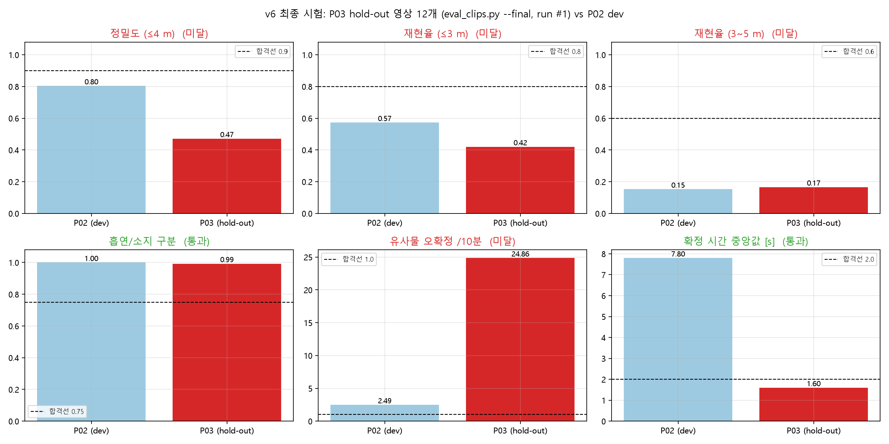

---

## 2. 진행 상황

| 항목 | 상태 |
| --- | --- |
| 사진 촬영 | ✅ P01 2,962장 (S1 1,621 + S2 510 + S3 831), P02 731장, P03 636장 |
| P01 사진 담배 위치 검수 | ✅ S1·S2·S3 전부 (확인 1,728장, 제외 11장) |
| 시험 영상 | ✅ P02 13개, P03 12개, 정답 확인 끝 |
| 모델 학습 | ✅ v1, v3exp, v3, v4, v5, v6 (5절) |
| P02 영상으로 비교 | ✅ v6가 정밀도·오확정 기준 최고, 합격선은 미달 |
| **P03 최종 시험** | ✅ **2026-11-18 v6로 1회 실행 → 불합격** (`acceptance/holdout_runs.log` run #1) |
| 여러 명일 때 우선순위 | ✅ 프로그램과 모의실험 완료 |
| 로봇(ROS2) 이식 | 🔧 코드 작성·Windows 검증 완료(테스트 222개), 라즈베리파이 실행 대기 (6절) |

---

## 3. 프로젝트 구조 (개발자용)

```
ASH-E/
├─ src/ash_e_core/        ROS 없이 동작하는 인식 핵심 코드 (사람 추적, 담배 판정, 안정화, 거리 추정, 뎁스 정렬, 우선순위)
├─ src/ash_e_msgs/        ROS2 메시지 정의 5종
├─ src/ash_e_perception/  ROS2 인식 노드, launch·config, 도구(video_to_bag, dump_jsonl, 보정, depth_check)
├─ src/ash_e_priority/    ROS2 우선순위 노드, 가짜 입력 발행기, 전체 기동 launch
├─ prototype/             웹캠 프로토타입: 촬영(capture.py), 실시간 실행·녹화(run_webcam.py),
│                         평가(eval_images.py, eval_clips.py), 보고서 그래프(report_figures.py, report_val_common.py),
│                         우선순위 모의실험(sim_priority.py), 정답 검수 도구(review_labels.py),
│                         이식 동등성 비교(log_replay_jsonl.py, compare_jsonl.py)
├─ training/              담배 검출기 데이터셋 만들기·학습·ONNX 내보내기
├─ acceptance/            합격 기준과 해시 잠금, hold-out 실행 기록
├─ docs/                  예전 안내서, 보고서 그래프(figures/)
├─ _workspace/            설계서, 작업 노트, 검증 보고서
├─ .claude/               개발 하네스(에이전트와 스킬 정의)
├─ HANDOFF.md             다음 세션 인수인계
└─ CLAUDE.md
```

- 설계서 `_workspace/01_planner_spec.md` · 인식 노트 `_workspace/02a_perception_notes.md`(1단계), `02b_perception_notes.md`(2단계) · 우선순위 노트 `02a_priority_notes.md`, `02b_priority_notes.md` · 검증 보고서 `03a_qa_report.md`, `03b_qa_report.md`
- 전체 테스트: `python -m pytest -q` (2026-11-18 이식 후: 222 passed)
- 실시간 실행: `python prototype\run_webcam.py` (기본 담배 모델 v6)
- 개발 순서: **1단계(완료)** 윈도우 웹캠으로 정확도 검증 → **2단계(진행 중)** ROS2 Jazzy + 라즈베리파이5 + 뎁스카메라로 이식. 로봇 주행과 넛지 UI는 범위 밖.

---

## 4. 데이터 출처와 라이선스

- 학습에는 직접 촬영한 사진과 공개 데이터셋(CigDet, CC BY 4.0), COCO 일부, 합성 이미지를 사용합니다. 출처와 조건은 `data/SOURCES.md`에 기록합니다. COCO 이미지는 비상업 학습에만 쓰고 재배포하지 않으며, 이 저장소에도 올리지 않습니다.
- 객체 검출에 Ultralytics YOLO11(AGPL-3.0)을 사용합니다. 졸업작품(비상업) 용도입니다.
- 이 저장소의 코드에는 아직 별도 라이선스를 지정하지 않았습니다.

---

## 5. 담배 검출 모델 개발 보고서 (v1 ~ v6)

> 이 절의 숫자는 모두 이 PC에서 실제로 실행한 결과 파일(`training/runs/*/results.csv`, `data/*/build_report.json`, `_workspace/eval_out/*`)에서 읽었습니다. 요약 수치는 `docs/figures/summary.json`에도 있습니다.
> P02(dev) 평가는 모델 비교·조정용 참고값입니다. 합격 판정은 P03(hold-out) 최종 시험(5-7)으로만 했고, P03은 v6로 한 번만 실행했습니다. P03 결과는 모델 선택이나 조정에 쓰지 않았습니다.

### 5-1. 시스템 구성과 사용 모델·라이브러리

인식은 **2단계 구조**입니다. 먼저 사람 자세(포즈) 모델로 사람과 손목·입 위치를 찾고, 그 주변을 잘라낸 작은 영역(ROI, 192×192)에서 담배 검출 모델을 돌립니다. 담배 박스가 입 근처면 **smoking(흡연)**, 손 근처면 **holding(소지)**으로 판정하고, 1.5초 창에서 안정화한 뒤 "확정"합니다.

| 구분 | 내용 |
| --- | --- |
| 사람·자세 모델 | YOLO11n-pose (COCO 사전학습, 입력 320), `models/pose.onnx` |
| 담배 검출 모델 | **YOLO11n detect, 1클래스(`cigarette`), 입력 192×192**, 파라미터 약 2.6 M, ONNX 약 10.5 MB (`models/cig_roi_v6.onnx`) |
| ROI 규칙 | 입 ROI = 머리 크기 × 1.6, 손 ROI = 손목 주변 × 1.4, 최소 24 px, 사람 최대 4명 (`src/ash_e_core/ash_e_core/config.py`) |
| 판정 기준값 | 담배 신뢰도 `cig_conf_thresh` 0.35, 사람 신뢰도 0.40, 처리율 8 Hz |
| 안정화 | 창 1.5 s, 확정 비율 0.6(최소 4회 관측), 해제 비율 0.25 / 1.0 s 유지, smoking 래치 20 s |
| 실행 환경 | Windows 11, Python 3.12.10, **CPU 전용**(AMD Ryzen AI Max+ 395, 32 스레드, GPU 미사용) |
| 학습 라이브러리 | Ultralytics 8.4.190, PyTorch 2.14.1+cpu, torchvision 0.29.1 |
| 추론 라이브러리 | ONNX Runtime 1.31.1, OpenCV 4.11.0.86, NumPy 1.26.4 |
| 분석·그래프 | matplotlib 3.11.2, scipy 1.17.1, pytest 9.1.1 (전체 목록 `requirements.txt`) |

### 5-2. 데이터 구성

#### (1) 직접 촬영한 데이터

모든 참가자는 성인이며 서면 동의를 받았습니다. 담배는 **불을 붙이지 않은** 실물 또는 모형입니다. 노트북 웹캠(1280×720)으로 찍었고, 참가자는 ID로만 기록합니다. 학습·조정·최종 시험에 **서로 다른 사람**을 씁니다.

| 참가자 | 용도 | 세션 | 사진 | 영상 |
| --- | --- | --- | --- | --- |
| **P01** | **학습**(train/val) | S1 (2026-11-10) | 1,621장 (holding 337, mouth 396, none 184, similar 357, gesture 347) | - |
| P01 | 학습 | S2 (2026-11-12) | 510장 (holding 270: 1·2·3 m, mouth 240: 3·4 m) | - |
| P01 | 학습 (보충) | S3 (2026-11-17) | 831장 (holding 399, mouth 99, similar 333)¹ | - |
| **P02** | **dev**(조정·비교용) | S1 | 731장 → 검수 평가 사진 **366장** | **13개, 9.0분** |
| **P03** | **hold-out**(최종 시험) | S1 | 636장 → 검수 평가 사진 318장 | **12개, 8.6분** |
| **합계** | | | **4,329장** | **25개, 17.6분** |

¹ S3는 처음 기록(meta.jsonl)에 holding 310 / mouth 190이었으나, 검수할 때 사진을 시나리오 폴더 사이에서 옮겨 현재 폴더 기준 holding 399 / mouth 99입니다.

- **시나리오:** holding(손에 듦), mouth(입에 묾 = 흡연 자세), none(아무것도 없음), similar(펜·휴대폰·막대 등 유사물), gesture(빈손이나 휴대폰을 입 근처로 가져가는 등 헷갈리는 동작). 영상에는 side(옆모습)와 walking(걷기)이 추가됩니다.
- **거리·각도:** 1~5 m, 정면·좌우 45°·옆모습. P01은 2~3 m에 많고 5 m가 적습니다(아래 그림 오른쪽).

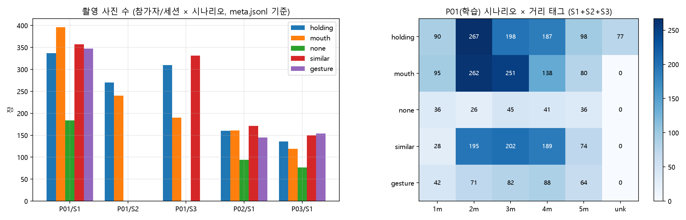

#### (2) 사람 검수(라벨링)

P01 holding·mouth 사진은 모델로 박스 초안을 만든 뒤(`prelabel.py`) **사람이 한 장씩 확인·수정**했습니다(`review_labels.py`).

| 세션 | 확인(ok) | 제외(ignore) |
| --- | --- | --- |
| S1 | holding 320, mouth 410 | mouth 1 |
| S2 | holding 262, mouth 238 | holding 4, mouth 6 |
| S3 | holding 402, mouth 96 | 0 |
| **합계** | **1,728장** | **11장** |

- 제외 = 담배가 30 % 미만으로 보이거나 너무 흐린 사진.
- none·similar·gesture 장면은 담배가 없으므로 **음성(배경) 학습 데이터**로 씁니다. 휴대폰·펜이 찍힌 장면도 포함합니다.
- P02 평가 사진 366장과 P03 평가 사진 318장, 영상 25개의 정답도 사람이 확인했습니다. P03은 확인 직후 SHA-256 매니페스트로 잠갔습니다(사진 637개 파일, 영상은 첫 최종 시험 때 잠김).

#### (3) 공개·합성 데이터 (모든 버전에 공통)

| 출처 | 내용 | 용도 |
| --- | --- | --- |
| CigDet (Mendeley, CC BY 4.0) | 250×250 근접 사진 557장, 담배 박스 1개씩 | 양성 |
| COCO 2017 val 일부 | 사람 사진 1,164장 (none 1,000, 유사물 164: 휴대폰·칼·숟가락·포크·칫솔·방망이) | 음성(하드 네거티브) |
| 합성(copy-paste) | CigDet 담배를 COCO 사람의 입·손에 붙인 300장 | 양성 (train 양성의 20 %) |

이 셋을 포즈 모델로 잘라 만든 ROI 세트가 `data/roi_ds_v2`(train 5,266 / val 506 ROI)입니다. **공개·합성 데이터는 평가에 쓰지 않았습니다.**

#### (4) 버전별 학습 ROI 수

ROI 1개 = 학습 이미지 1장(192×192)입니다. 양성 = 담배 박스가 있는 ROI, 음성 = 담배가 없는 ROI.

| 버전 | P01 데이터 | P01 사용 프레임 (train/val) | train 양성 / 음성 | val 양성 / 음성 | **train 합계** | **val 합계** |
| --- | --- | --- | --- | --- | --- | --- |
| v1 | 없음 | - | 1,625 / 3,641 | 186 / 320 | **5,266** | **506** |
| v3exp | S1, 검수 없는 의사 라벨 | 1,073 / 193 | 3,086 / 9,969 | 274 / 718 | **13,055** | **992** |
| v3 | S1, 사람 검수 | 1,292 / 256 | 3,555 / 12,055 | 354 / 841 | **15,610** | **1,195** |
| v4 | S1+S2, 사람 검수 | 1,723 / 335 | 4,583 / 14,658 | 434 / 989 | **19,241** | **1,423** |
| v5 | S1+S2+S3, 재검수(제외 86장) | 2,337 / 497 | 4,984 / 19,428 | 429 / 1,368 | **24,412** | **1,797** |
| **v6** | v5 + 제외 사진 75장 복구(제외 11장) | 2,398 / 508 | 5,091 / 19,675 | 453 / 1,383 | **24,766** | **1,836** |

- train/val 분할: P01은 시나리오별로 연속 20프레임 블록을 만들고 **5번째 블록마다 val**로 보냅니다(연속 프레임이 train과 val에 나뉘어 새는 것을 줄이기 위함). 공개 데이터는 원본 분할(CigDet test, COCO 이미지 ID % 10 == 0)을 val로 씁니다.
- 학습에는 P01만 들어갑니다. P02 = dev(조정), P03 = hold-out(최종 시험).

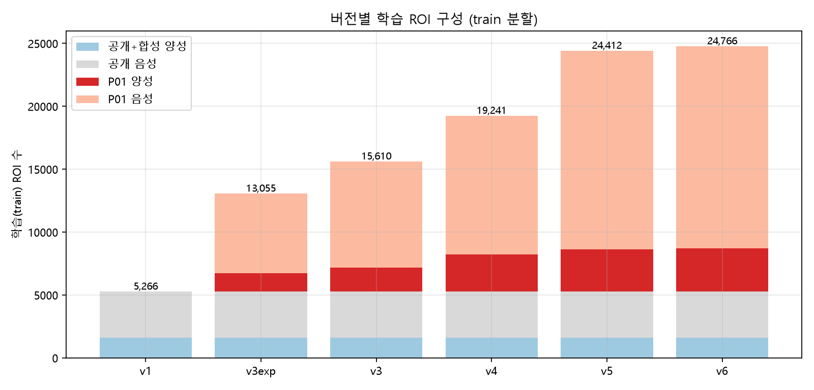

### 5-3. 버전별 변경 사항

> "v2"라는 이름의 모델은 없습니다. `roi_ds_v2`는 v1 모델이 쓴 **데이터셋** 이름이고, `v2_small`은 3 epoch짜리 동작 확인 학습이었습니다. v3exp는 v3와 같은 날 비교용으로 만든 실험 모델입니다.

| 버전 | 날짜 | 모델 파일 (학습 run) | 바뀐 점 | 결과 요약 | 채택 |
| --- | --- | --- | --- | --- | --- |
| v1 | 11-10 | `cig_roi.onnx` (`cig_roi_v2`) | 공개+합성만으로 처음 본 학습. COCO 사전학습 YOLO11n에서 시작, 80 epoch | 4~5 m는 거의 못 잡음. 휴대폰·펜·손-입 동작 오검출이 매우 많음(P02 영상 오확정 16건) | 초기 기본 |
| v3exp | 11-11 | `cig_roi_v3exp.onnx` | P01 S1을 **사람 검수 없이** v1 박스(신뢰도 0.5 이상)로 라벨링해 추가. v1에서 이어 30 epoch | 오검출 감소. v1이 못 잡던 원거리 양성은 학습에 안 들어감(구조적 한계) | 실험 |
| v3 | 11-11 | `cig_roi_v3.onnx` | P01 S1 **사람 검수 라벨**로 교체. v1에서 이어 30 epoch | P02 사진 오검출 77 → 47건 | 11-11 ~ 11-18 기본 |
| v4 | 11-13 | `cig_roi_v4.onnx` | S2(holding 1~3 m, mouth 3~4 m) 510장 추가. v1에서 이어 30 epoch | 영상 정밀도 0.52 → 0.62. 원거리 입 담배(3 m, 4.5 m)를 진짜로 잡은 유일한 버전 | 미채택 |
| v5 | 11-18 | `cig_roi_v5.onnx` | S3 831장 추가(유사물 음성 331장 포함), S1·S2 재검수. **COCO 사전학습 YOLO11n에서 새로 시작**, 최적화기 자동 선택이 MuSGD로 바뀜 | 사진 기준 가장 좋음(F1 0.635). 영상에서 원거리 입 담배를 놓쳐 3~5 m 재현율 0.05 | 미채택 |
| **v6** | 11-18 | `cig_roi_v6.onnx` | 재검수에서 제외했던 86장 중 75장 복구(대부분 4~5 m 정면 입 담배). 설정은 v5와 같음 | P02 영상 정밀도 0.804·오확정 1건으로 최고. mouth_002(3 m) 회복 | **최종 (11-18)** |

**v5부터 함께 바뀐 두 가지(원인 분석용):**
1. v3·v4는 v1의 가중치(`cig_roi_v2/weights/best.pt`)에서 이어 학습했지만, v5·v6는 학습 명령에 `--weights`를 주지 않아 **기본값인 COCO 사전학습 `models/yolo11n.pt`에서 새로 시작**했습니다(v6는 로그의 `model=...yolo11n.pt`로 확인. v5는 재개 때문에 첫 로그가 덮여 실행 명령으로 확인).
2. Ultralytics의 `optimizer=auto`는 학습 반복 수에 따라 최적화기를 고릅니다. 데이터가 늘면서 v1~v4는 **AdamW(lr 0.002)**, v5·v6는 **MuSGD(lr 0.01)**가 선택됐습니다.

데이터와 이 두 가지가 동시에 바뀌어서, v4 → v5의 원거리 성능 하락이 어느 쪽 때문인지는 분리하지 못했습니다. v6는 데이터만 되돌린 실험이고, mouth_002(3 m)는 회복했지만 mouth_003(4.5 m)는 회복하지 못했습니다.

### 5-4. 학습 설정과 학습 결과

모든 버전 공통: 입력 192, batch 32, seed 0, CPU, AMP 끔, 증강(회전 ±15°, 좌우 반전 0.5, 밝기 0.4, mosaic 1.0, 마지막 5 epoch mosaic 끔). `training/train_cig_roi.py`.

| 버전 | 시작 가중치 | 최적화기 | epoch (patience) | 학습 시간 | best epoch | val P | val R | val mAP50 | val mAP50-95 |
| --- | --- | --- | --- | --- | --- | --- | --- | --- | --- |
| v1 | yolo11n (COCO) | AdamW 0.002 | 80 (20) | 84분 (5,068 s) | 70 | 0.808 | 0.688 | 0.724 | 0.358 |
| v3exp | v1 best | AdamW 0.002 | 30 (10) | 74분 (4,457 s) | 25 | 0.870 | 0.755 | 0.814 | 0.414 |
| v3 | v1 best | AdamW 0.002 | 30 (10) | 89분 (5,351 s) | 25 | 0.813 | 0.652 | 0.703 | 0.358 |
| v4 | v1 best | AdamW 0.002 | 30 (10) | 약 1.5시간² | 28 | 0.842 | 0.668 | 0.734 | 0.346 |
| v5 | yolo11n (COCO) | MuSGD 0.01 | 30 (10) | 약 2.4시간² | 27 | 0.798 | 0.709 | 0.765 | 0.341 |
| **v6** | yolo11n (COCO) | MuSGD 0.01 | 30 (10) | **149분 (8,940 s)** | **26** | **0.773** | **0.724** | **0.756** | **0.337** |

² 학습 도중 끊겨 `--resume`로 이어 학습했기 때문에 정확한 총 시간 기록이 없습니다(v5는 19~30 epoch에 3,476 s, epoch당 약 290 s).

- **best epoch**: Ultralytics 8.4는 적합도(fitness)를 **mAP50-95**로 정하고, 그 값이 가장 높은 epoch을 `best.pt`로 저장합니다(`ultralytics/utils/metrics.py`, 가중치 `[P, R, mAP50, mAP50-95] = [0, 0, 0, 1]`). 위 표는 그 epoch의 값입니다.
- **주의:** 각 버전의 val 세트가 달라서(5-2 (4) 표) **이 표의 숫자로 버전끼리 우열을 비교하면 안 됩니다.** 예: v3exp의 val mAP50 0.814가 높은 것은 val 양성이 v1이 이미 잘 잡는 의사 라벨이라 쉬웠기 때문입니다. 같은 기준의 비교는 5-5(공통 검증)와 5-6(P02)에 있습니다.

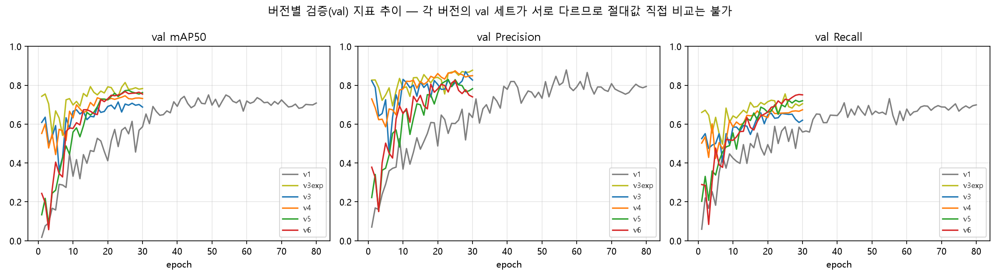

#### 학습 곡선 (손실·적합도)

각 그림 위쪽은 손실(box = 박스 위치 오차, cls = 담배/배경 분류 오차, DFL = 박스 경계 분포 오차)과 학습률, 아래쪽은 val 지표입니다. 점선은 best epoch입니다.

| 버전 | 그림 | 관찰 |
| --- | --- | --- |
| v1 | [train_curves_v1.png](docs/figures/train_curves_v1.png) | 80 epoch 동안 train·val 손실이 함께 감소. 과적합 신호 없음 |
| v3exp | [train_curves_v3exp.png](docs/figures/train_curves_v3exp.png) | v1에서 이어 학습. val이 쉬워 지표가 가장 높게 나옴 |
| v3 | [train_curves_v3.png](docs/figures/train_curves_v3.png) | v1에서 이어 학습해 시작부터 mAP50 약 0.6. 20 epoch 이후 평탄 |
| v4 | [train_curves_v4.png](docs/figures/train_curves_v4.png) | v3와 비슷한 모양. 15 epoch에서 끊겨 재개 |
| v5 | [train_curves_v5.png](docs/figures/train_curves_v5.png) | 새로 시작해 1~5 epoch(워밍업)에 val 손실이 크게 튐. 25 epoch 이후 평탄 |
| **v6** | [train_curves_v6.png](docs/figures/train_curves_v6.png) | v5와 같은 모양. 3 epoch(워밍업 끝)에 val mAP50 0.06까지 떨어졌다가 회복, 20 epoch 이후 0.75 안팎에서 평탄. 마지막 5 epoch(mosaic 끔)에 train 손실은 빠르게 내려가는데 val box 손실은 1.97 → 2.03으로 조금 올라 **과적합 초기 신호**가 보임. P도 0.82 → 0.74로 내려가 best는 26 epoch |

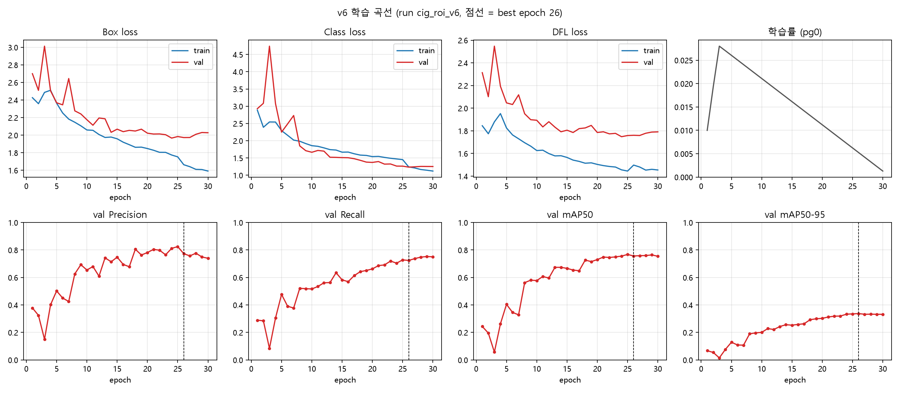

### 5-5. 공통 검증 세트 비교 (ROI 단위)

5-4의 val 숫자는 버전마다 val 세트가 달라 비교할 수 없으므로, **모든 버전을 v6 val 세트(공개 506 + P01 1,330 ROI) 하나로 다시 평가**했습니다(`prototype/report_val_common.py`, Ultralytics validator, IoU 0.7 NMS). P01 val 프레임은 모든 버전에서 같은 블록 규칙으로 val에만 들어가므로 어느 버전의 학습에도 쓰이지 않았습니다.

| 버전 | 전체 P / R | 전체 mAP50 / mAP50-95 | **P01(로봇 시점) mAP50** | 공개 데이터 mAP50 |
| --- | --- | --- | --- | --- |
| v1 | 0.695 / 0.450 | 0.480 / 0.225 | 0.323 | 0.724 |
| v3exp | 0.649 / 0.517 | 0.454 / 0.228 | 0.315 | 0.730 |
| v3 | 0.635 / 0.519 | 0.509 / 0.249 | 0.407 | 0.701 |
| v4 | 0.792 / 0.615 | 0.627 / 0.293 | 0.602 | 0.692 |
| v5 | 0.810 / 0.713 | **0.767** / **0.342** | **0.831** | 0.673 |
| **v6** | 0.773 / **0.724** | 0.757 / 0.338 | 0.827 | 0.652 |

- 로봇 시점(P01) 성능은 P01 데이터가 늘어날수록 크게 올랐습니다(0.32 → 0.83). 대신 공개 데이터(근접 사진) 성능은 조금씩 내려갔습니다(0.72 → 0.65). 모델이 로봇 시점에 맞춰진 것입니다.
- v5와 v6는 이 기준에서 거의 같습니다(차이 0.01 이내).
- 이 값은 **P01 한 사람**의 사진입니다. 다른 사람(P02, P03)에서는 5-6, 5-7처럼 훨씬 낮습니다.

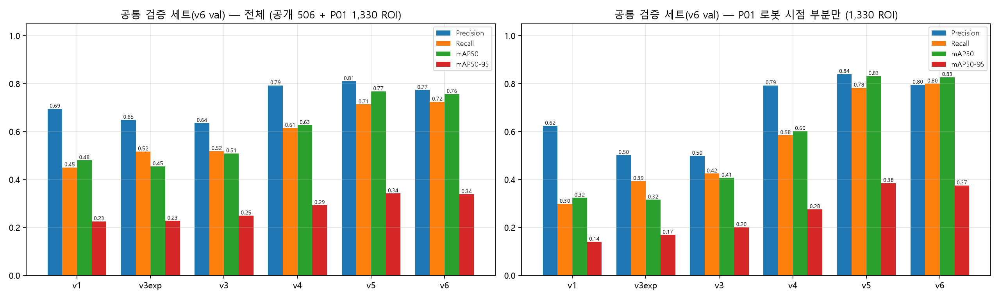

### 5-6. P02(dev) 평가 비교

#### (1) 영상 평가 — 합격 기준과 같은 방식

`prototype/eval_clips.py`가 P02 영상 13개(양성 노출 3.4분, 유사물 노출 4.0분)를 다시 재생하며 **안정화 후 확정 상태**로 지표를 셉니다. 합격선은 `acceptance/acceptance.yaml`(잠김)에서 읽습니다. 괄호 = 분자/분모(프레임 수).

| 지표 | 합격선 | v1 | v3exp | v3 | v4 | v5 | **v6** |
| --- | --- | --- | --- | --- | --- | --- | --- |
| 정밀도 (≤4 m) | ≥ 0.90 | 0.400 | 0.576 | 0.524 | 0.624 | 0.760 | **0.804** (427/531) |
| 재현율 (≤3 m) | ≥ 0.80 | 0.532 | 0.534 | 0.545 | 0.576 | **0.613** | 0.573 (311/543) |
| 재현율 (3~5 m) | ≥ 0.60 | 0.612³ | 0.620³ | 0.539³ | 0.320 | 0.049 | 0.153 (116/760) |
| 흡연/소지 구분 | ≥ 0.75 | 0.978 | 0.938 | 0.967 | 0.973 | **1.000** | **1.000** ✅ |
| 유사물 오확정 (10분당) | ≤ 1 | 32.4 (16건) | 12.5 (6건) | 12.5 (5건) | 10.0 (4건) | 5.0 (2건) | **2.5 (1건)** |
| 확정 시간 (중앙값) | ≤ 2 s | 0.40 s | 0.40 s | 0.53 s | 0.47 s | 3.87 s | 7.80 s |

³ v1·v3exp·v3의 3~5 m 재현율에는 **진짜 담배가 아니라** holding_002의 후드티 가슴 로고와 휴대폰 모서리를 잡아 "확정"된 것이 섞여 있습니다(박스 위치를 장면으로 확인). `eval_clips.py`는 확정 여부만 세고 박스 위치는 확인하지 않으므로, `prototype/box_sheet.py`로 박스 위치를 따로 확인했습니다.

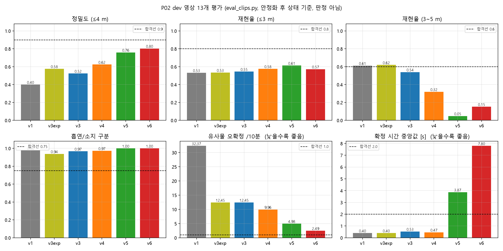

**v6 박스 위치 확인 결과**
- mouth_001(1~2 m): 0.4초 만에 확정, 양성 구간의 99 %를 확정.
- **mouth_002(3 m): 확정(박스가 입의 담배 위).** v5에서 놓쳤던 장면을 되찾았습니다. 다만 신뢰도가 0.35~0.43으로 기준값 근처라 18.8초 뒤에야 확정됩니다.
- side_001(옆모습), walking_001(걷기): 입의 담배를 잡아 확정.
- mouth_003(4.5 m), holding_001(2 m), holding_002(4 m): 확정 안 됨.
- 남은 오확정 1건: similar_003에서 손에 든 흰 막대.
- 확정 시간 중앙값이 7.8초로 길어진 것은 원거리·옆모습에서 신뢰도가 기준값 근처에 머물기 때문입니다.

#### (2) 사진 평가 — 프레임 단위 혼동행렬

`prototype/eval_images.py`로 P02 검수 사진 366장(정답: none 179, holding 76, smoking 111)을 평가했습니다. 안정화 없이 프레임마다 판정한 값(raw)이고, 판정 기준값은 0.35입니다.

| 지표 | v1 | v3exp | v3 | v4 | v5 | **v6** |
| --- | --- | --- | --- | --- | --- | --- |
| TP / FN / FP / TN | 86 / 101 / 77 / 102 | 82 / 105 / 55 / 124 | 83 / 104 / 47 / 132 | 83 / 104 / 57 / 122 | 106 / 81 / 41 / 138 | 92 / 95 / 44 / 135 |
| 정밀도 | 0.528 | 0.599 | 0.638 | 0.593 | **0.721** | 0.676 |
| 재현율 | 0.460 | 0.439 | 0.444 | 0.444 | **0.567** | 0.492 |
| F1 | 0.491 | 0.506 | 0.524 | 0.508 | **0.635** | 0.570 |
| 3클래스 정확도 | 0.503 | 0.557 | 0.577 | 0.544 | **0.661** | 0.609 |
| 흡연/소지 구분 | 0.953 | 0.976 | 0.952 | 0.928 | **0.981** | 0.957 |
| 오검출: 유사물 / 동작 / 빈 장면 / 기타 | 44 / 18 / 12 / 3 | 33 / 17 / 5 / 0 | 25 / 16 / 5 / 1 | 31 / 20 / 6 / 0 | 19 / 16 / 6 / 0 | 21 / 16 / 6 / 1 |

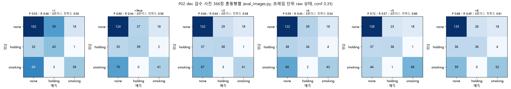

**판정 기준값을 바꾸면** (`prototype/sweep_dev_thresholds.py`, 같은 366장):

| 기준값 | v3 P / R | v4 P / R | v5 P / R | **v6 P / R** |
| --- | --- | --- | --- | --- |
| 0.25 | 0.619 / 0.556 | 0.608 / 0.556 | 0.709 / 0.679 | 0.701 / 0.652 |
| 0.35 (운영값) | 0.636 / 0.439 | 0.587 / 0.433 | 0.719 / 0.561 | 0.676 / 0.492 |
| 0.45 | 0.635 / 0.353 | 0.588 / 0.358 | 0.727 / 0.428 | 0.695 / 0.353 |
| 0.55 | 0.662 / 0.283 | 0.602 / 0.283 | 0.735 / 0.267 | 0.689 / 0.225 |
| 0.65 | 0.700 / 0.187 | 0.816 / 0.214 | 0.600 / 0.032 | 0.619 / 0.070 |

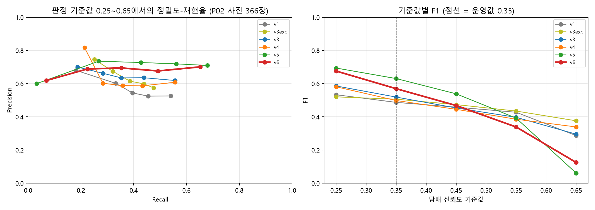

- 기준값을 올려도 정밀도가 거의 오르지 않습니다. 유사물의 신뢰도가 진짜 담배와 같은 범위에 있다는 뜻이고, 기준값 조정만으로는 합격선(정밀도 0.90)에 갈 수 없습니다.
- **사진에서는 v5가, 영상에서는 v6가 더 좋은 이유:** 사진 366장은 장면이 고르게 섞여 있지만, 영상은 한 장면이 30초씩 이어지고 안정화(1.5 s 창의 60 %)를 넘어야 확정됩니다. v6는 원거리 장면(mouth_002)을 꾸준히 약하게 잡아 확정까지 가고, 유사물 장면에서는 확정까지 가는 경우가 적습니다.

### 5-7. 최종 모델 v6 품질 검증

#### (1) P03 hold-out 최종 시험 (합격 판정)

2026-11-18 12:08, `eval_clips.py --final --cig-model models/cig_roi_v6.onnx`를 **한 번** 실행했습니다(`acceptance/holdout_runs.log` run #1). 실행 전에 P03 영상 12개를 `data/eval/holdout/clips/`로 복사했고, 이 실행에서 영상 SHA-256 매니페스트(`acceptance/holdout_clips_manifest.json`)가 만들어져 이후 영상이 바뀌면 시험이 거부됩니다. 양성 노출 3.3분, 유사물 노출 4.0분.

| 지표 | 합격선 | **P03 결과** | 분자/분모 | 95 % Wilson (프레임) | 95 % 영상 부트스트랩 | 판정 |
| --- | --- | --- | --- | --- | --- | --- |
| 정밀도 (≤4 m) | ≥ 0.90 | **0.471** | 418 / 887 | [0.439, 0.504] | [0.00, 1.00] | ❌ |
| 재현율 (≤3 m) | ≥ 0.80 | **0.420** | 286 / 681 | [0.383, 0.457] | [0.00, 0.91] | ❌ |
| 재현율 (3~5 m) | ≥ 0.60 | **0.166** | 132 / 795 | [0.142, 0.193] | [0.00, 0.52] | ❌ |
| 흡연/소지 구분 | ≥ 0.75 | **0.993** | 415 / 418 | [0.979, 0.998] | [0.98, 1.00] | ✅ |
| 유사물 오확정 (10분당) | ≤ 1 | **24.9** | 10건 / 4.0분 | - | [0.0, 38.8] | ❌ |
| 확정 시간 (중앙값) | ≤ 2 s | **1.6 s** | 3구간 | - | [0.4, 5.7] | ✅ |

**판정: 불합격** (6개 중 2개 통과). P02(dev)보다 정밀도·오확정이 크게 나빠졌습니다(정밀도 0.804 → 0.471, 오확정 1 → 10건). 학습하지 않은 새 사람에게 일반화되지 않았다는 뜻입니다.

| P03 영상 | 결과 |
| --- | --- |
| mouth_001 (가까움) | 0.4초 만에 확정, 구간의 99 % |
| mouth_002 (3 m) | 1.6초 만에 확정, 구간의 58 % |
| side_001 (옆모습) | 5.7초 만에 확정, 구간의 48 % |
| mouth_003 (4.5 m), walking_001, holding_001 (2 m), holding_002 (4 m) | 확정 안 됨 |
| 오확정 10건 | gesture_002 4건: **얼굴 앞에 든 휴대폰 모서리**를 입 근처 담배로 판정 · similar_001 3건, similar_002 3건: **입에 댄 펜·막대**를 담배로 판정 |


#### (2) ROI 단위 품질 지표 (공통 검증 세트, Ultralytics validator)

v6를 공통 검증 세트(1,836 ROI, 담배 박스 453개)로 평가한 PR·F1 곡선과 혼동행렬입니다.

| 지표 | 값 |
| --- | --- |
| mAP50 / mAP50-95 | 0.757 / 0.338 |
| F1 최대 지점의 P / R | 0.773 / 0.724 |
| 운영 기준값 0.35에서 P / R | 0.839 / 0.634 |
| 운영 기준값 0.35 혼동행렬 | 맞힘(TP) 303, 헛짚음(FP) 39, 놓침(FN) 150 |
| ROI 1개 추론 (PyTorch, CPU) | 1.7 ms |

| PR 곡선 | F1 곡선 |
| --- | --- |
| 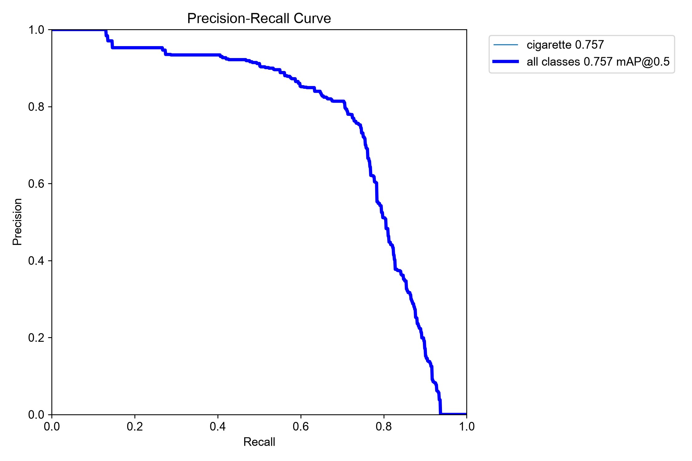 | 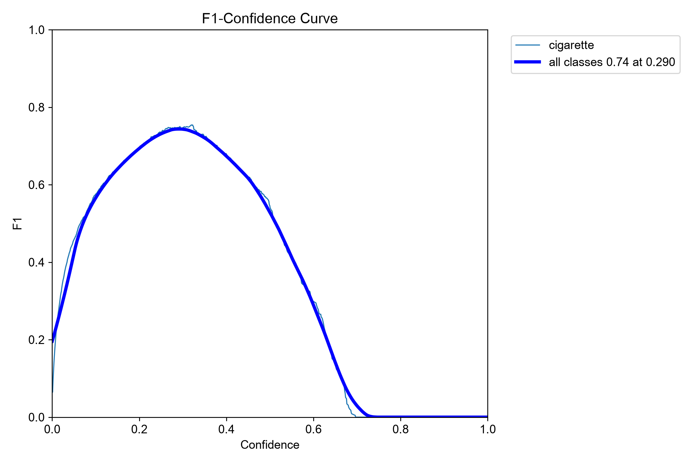 |
| **P 곡선** | **R 곡선** |
| 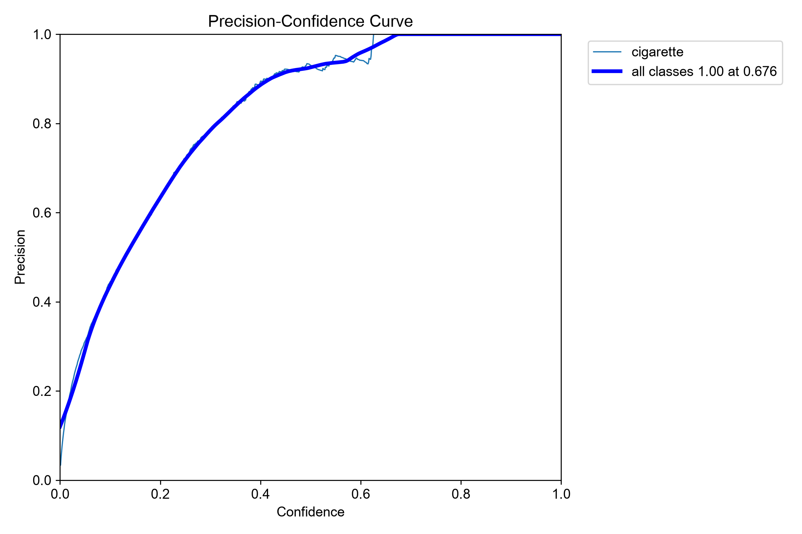 | 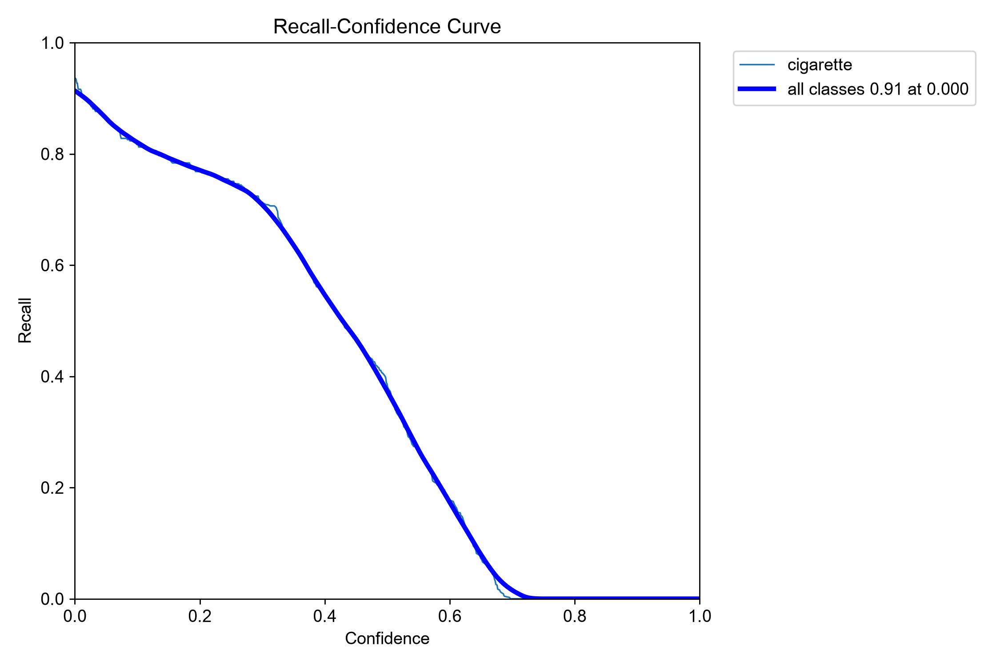 |
| **혼동행렬 (기준값 0.35)** | **정규화 혼동행렬 (기준값 0.35)** |
| 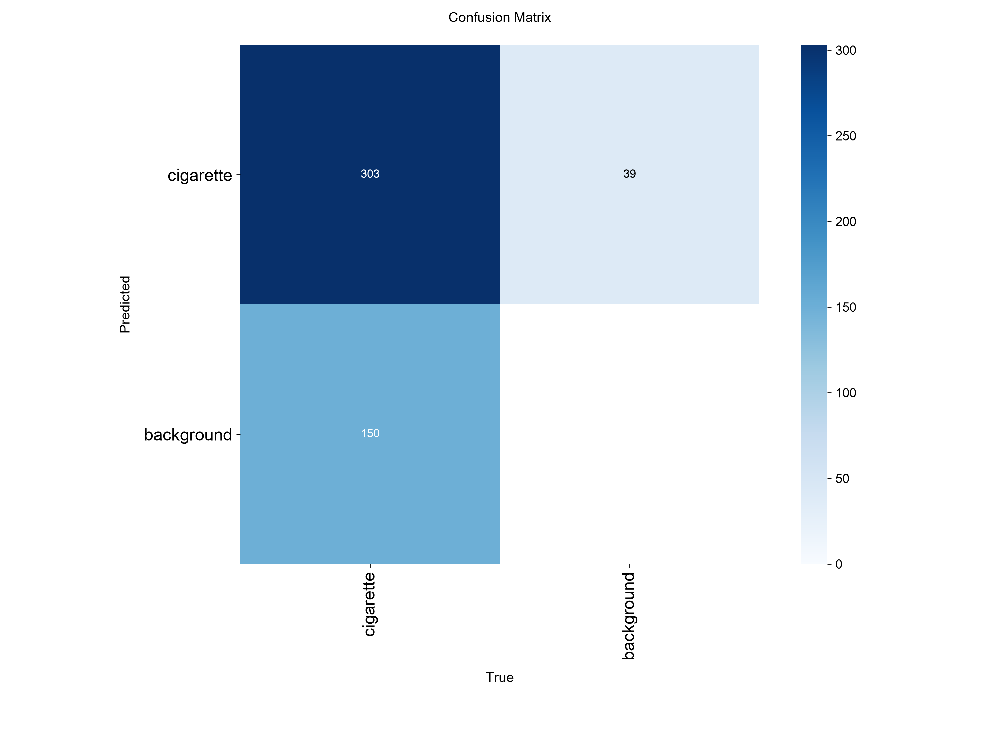 | 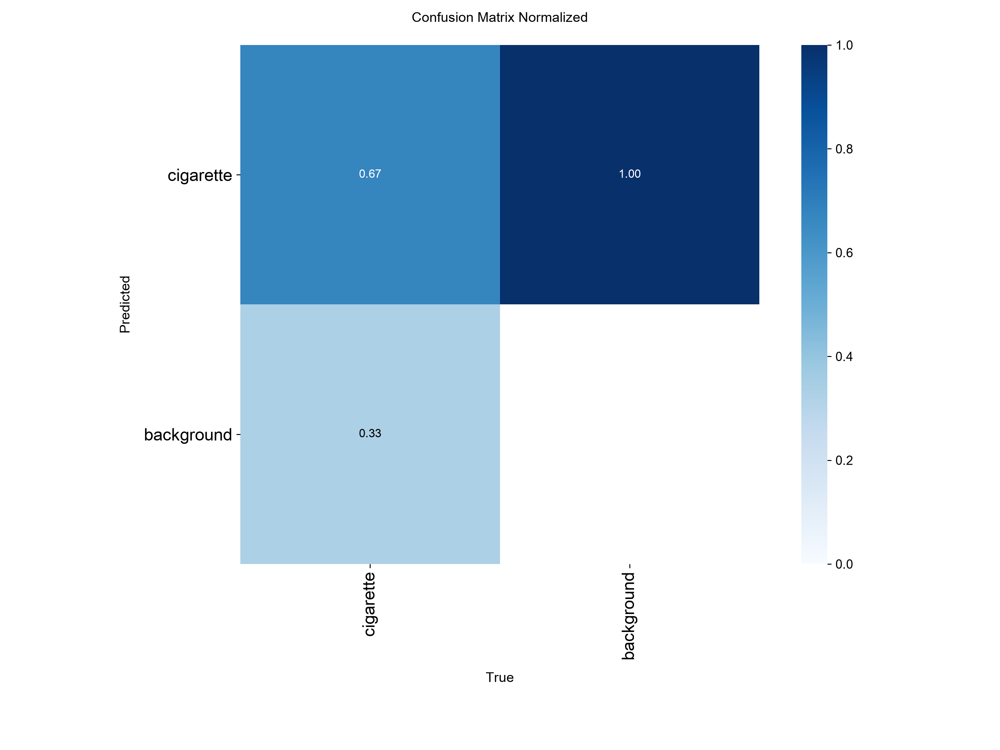 |

PR 곡선을 보면 재현율 0.7까지는 정밀도 0.8 이상을 유지하다가 그 뒤 급히 떨어지고, 재현율이 0.94를 넘지 못합니다. 담배 박스의 약 6 %는 기준값을 아무리 낮춰도 찾지 못한다는 뜻입니다(참고 절의 "최대 Recall이 mAP50의 천장" 참조).

#### (3) 영상별 확정 비율, 거리별 성능, 처리 시간 (P02, Windows PC)

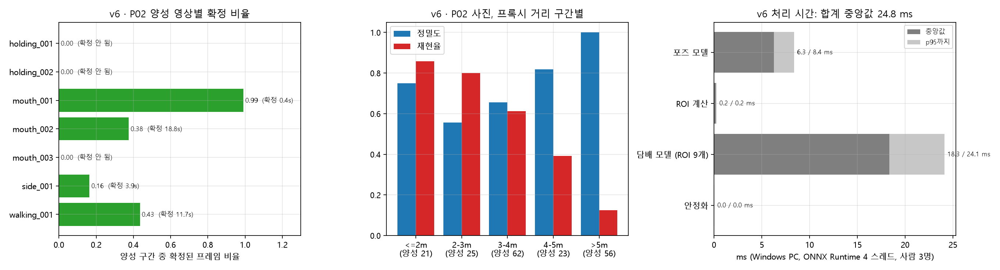

- **거리별(P02 사진):** ≤2 m 재현율 0.86, 2~3 m 0.80, 3~4 m 0.61, 4~5 m 0.39, 5 m 초과 0.13. 거리가 멀수록 급격히 떨어집니다. 담배가 ROI 안에서 몇 픽셀밖에 안 되기 때문입니다.
- **처리 시간** (`prototype/bench_latency.py`, 합성 1280×720 프레임, 사람 3명 = ROI 9개, ONNX Runtime 4 스레드): 프레임당 합계 중앙값 **24.8 ms**, p95 31.2 ms (포즈 6.3 ms, 담배 모델 18.3 ms, ROI 계산 0.2 ms, 안정화 0.03 ms). 약 40 fps에 해당합니다. **Windows PC 값이며 라즈베리파이5 값이 아닙니다.** 라즈베리파이5는 보통 5~10배 느리다고 보므로, 사람 3명에서 5 Hz 기준을 맞출 수 있는지는 2단계에서 직접 재야 합니다.

### 5-8. 품질 평가 방법과 지표 정의

| 평가 | 도구 | 데이터 | 무엇을 보나 |
| --- | --- | --- | --- |
| 학습 검증 | Ultralytics validator (`results.csv`) | 각 버전의 val ROI | ROI 단위 P, R, mAP50, mAP50-95, 손실 |
| 공통 검증 | `prototype/report_val_common.py` | 모든 버전을 v6 val ROI 1,836개로 | 같은 기준의 mAP, 혼동행렬, PR·F1 곡선 |
| 사진 평가 | `prototype/eval_images.py`, `sweep_dev_thresholds.py` | P02 검수 사진 366장 | 3×3 혼동행렬, P/R/F1, 거리 구간별 값, 오검출 종류, 기준값별 P/R |
| 영상 평가 (**합격 기준**) | `prototype/eval_clips.py` | P02 영상 13개, 최종은 P03 12개(`--final`) | 안정화 후 정밀도·재현율·구분 정확도·오확정·확정 시간, Wilson 95 % 구간, 영상 단위 부트스트랩 구간 |
| 박스 위치 확인 | `prototype/box_sheet.py` | 평가 영상 | "확정"된 박스가 실제 담배 위에 있는지 눈으로 확인 |
| 처리 시간 | `prototype/bench_latency.py` | 합성 프레임 | 단계별 지연시간 중앙값·p95 |
| 그래프·요약 | `prototype/report_figures.py` | 위 결과 파일 | 이 문서의 그림과 `docs/figures/summary.json` |

- **정밀도(Precision)** = TP ÷ (TP + FP): "담배 있다"고 한 것 중 맞은 비율. **재현율(Recall)** = TP ÷ (TP + FN): 실제 담배 중 찾은 비율. **F1** = 두 값의 조화평균. **mAP50** = IoU 0.5 기준 PR 곡선 아래 넓이(자세한 설명은 맨 아래 참고 절).
- **거리**는 웹캠 단계라 뎁스가 없어서 사람 박스 크기로 추정한 **프록시 거리**입니다.
- **유사물 오확정**: 유사물·동작 장면에서 담배로 "확정"된 횟수를 10분당으로 환산.
- **신뢰구간**: 프레임 Wilson 구간은 연속 프레임끼리 상관이 있어 실제보다 좁게 나옵니다. 영상 부트스트랩 구간은 영상이 12~13개뿐이라 매우 넓습니다. 유사물 노출이 4분이라 "10분당 1회 이하"는 이 데이터 양으로는 정밀하게 판단할 수 없습니다.

### 5-9. 종합 분석과 한계

**알게 된 것**
1. **사람 검수가 효과가 있었습니다.** 같은 S1 데이터로 의사 라벨(v3exp) → 검수 라벨(v3)로 바꾸자 P02 사진 오검출이 55 → 47건, 정밀도가 0.599 → 0.638로 좋아졌습니다.
2. **P01 데이터가 늘수록 학습한 사람(P01)에서는 크게 좋아졌습니다.** 공통 검증 P01 mAP50 0.32(v1) → 0.83(v6).
3. **새 사람에게는 일반화되지 않았습니다.** 같은 v6가 P02 영상 정밀도 0.804, P03 영상 0.471입니다. 학습 참가자가 한 명뿐인 것이 가장 큰 원인으로 보입니다(손 모양, 휴대폰·펜을 드는 방식, 옷이 사람마다 다름).
4. **원거리(3~5 m)가 약합니다.** 사진 기준 재현율이 4~5 m 0.39, 5 m 초과 0.13입니다. 담배가 ROI 안에서 몇 픽셀밖에 안 되고, P01 학습 데이터에도 5 m가 적습니다.
5. **유사물(펜·막대·휴대폰 모서리)과 담배는 판정 기준값으로 나눌 수 없습니다.** 기준값을 0.25 → 0.65로 올려도 정밀도가 거의 오르지 않습니다.
6. **흡연/소지 구분(P03 0.993)과 확정 속도(P03 1.6 s)는 합격선을 넘었습니다.** 문제는 "담배가 있는가"를 찾는 단계입니다.

**한계 (보고서에 반드시 적을 것)**
- 학습 참가자는 **P01 한 명**, 평가는 dev 1명(P02)·hold-out 1명(P03)입니다. 한 사람의 연속 프레임은 서로 독립이 아니라서 유효 표본은 사람 수에 가깝습니다. 결과는 "이 참가자들, 이 장소, 이 카메라"에서만 유효하며 일반 사용자 성능을 뜻하지 않습니다.
- 담배는 불을 붙이지 않았습니다(연기·불빛 없음).
- 거리는 프록시 추정값입니다(뎁스카메라는 2단계).
- 처리 시간은 Windows PC 값입니다.
- 공개 데이터(CigDet)는 근접 사진이라 로봇 시점과 다르고, COCO 이미지는 비상업 학습 전용입니다.
- P03 최종 시험은 이제 한 번 사용됐습니다. 앞으로 모델을 고친 뒤 P03로 다시 재면 P03가 조정에 쓰인 셈이 되므로, 다음 판정에는 **새 hold-out 참가자(P04 이상)**가 필요합니다.

**개선 방향 (제안)**
1. **학습 참가자 추가(P04 이상)** — 일반화 문제의 가장 직접적인 해결책. 특히 유사물(펜·막대)을 입에 대는 장면과 휴대폰을 얼굴 앞에 드는 장면을 여러 사람으로 찍기.
2. **원거리용 ROI 확대**: 3 m 이상에서 입·손 ROI를 더 크게 잘라 입력 해상도를 올리는 방법.
3. **학습 시작점 비교 실험(v7)**: v6 데이터 + v1 가중치에서 이어 학습 + AdamW. v4처럼 원거리를 잡으면서 v6처럼 오확정이 적은지 확인.

### 5-10. 결과 재현 명령

```
# 데이터셋 만들기 (P01 검수 결과 → ROI)
.venv\Scripts\python training\build_roi_own_reviewed.py --pid P01 --out data\roi_own_p01_reviewed_v6 --yaml data\roi_ds_v6.yaml --clean
# 학습 / ONNX 내보내기
.venv\Scripts\python training\train_cig_roi.py --data data\roi_ds_v6.yaml --epochs 30 --patience 10 --name cig_roi_v6
.venv\Scripts\python training\export_onnx.py --weights training\runs\cig_roi_v6\weights\best.pt --out models\cig_roi_v6.onnx
# P02 dev 평가 (영상 / 사진 / 기준값 스윕 / 박스 위치)
.venv\Scripts\python prototype\eval_clips.py --clips-dir data\raw_clips\P02 --cig-model models\cig_roi_v6.onnx --tag dev_p02_v6
.venv\Scripts\python prototype\eval_images.py --cig-model models\cig_roi_v6.onnx --tag p02_frames_v6
.venv\Scripts\python prototype\sweep_dev_thresholds.py --models models\cig_roi.onnx models\cig_roi_v3exp.onnx models\cig_roi_v3.onnx models\cig_roi_v4.onnx models\cig_roi_v5.onnx models\cig_roi_v6.onnx
.venv\Scripts\python prototype\box_sheet.py _workspace\eval_out\clips_dev_p02_v6 data\raw_clips\P02\S1 _workspace\eval_out\box_v6 mouth_002 mouth_003
# 공통 val 세트로 모든 버전 비교 (PR·F1 곡선 포함)
.venv\Scripts\python prototype\report_val_common.py --plots
# 처리 시간
.venv\Scripts\python prototype\bench_latency.py --cig-model models\cig_roi_v6.onnx --n 200 --warmup 20 --persons 3 --out _workspace\eval_out\latency_v6.json
# P03 최종 시험 (한 번만. 실행 기록이 acceptance/holdout_runs.log에 남음)
.venv\Scripts\python prototype\eval_clips.py --final --cig-model models\cig_roi_v6.onnx --tag holdout_p03_v6
# 이 문서의 그래프
.venv\Scripts\python prototype\report_figures.py
```

---

## 6. 라즈베리파이(ROS2) 이식과 설치 절차

### 6-1. 현재 상태

2026-11-18 담당자가 v6를 **"현재 수준으로 합격"**으로 선언했습니다(P03 불합격 수치를 알고 받아들인 예비 합격). 그래서 2단계(ROS2 이식)를 시작했습니다. 인식 성능이 실제 환경에서도 통하는지는 라즈베리파이 실기 시험에서 다시 확인합니다.

| 항목 | 상태 |
| --- | --- |
| ROS2 패키지 코드 | ✅ `ash_e_msgs`(메시지 5종), `ash_e_perception`(인식 노드·도구), `ash_e_priority`(우선순위 노드·가짜 입력·전체 기동) |
| 핵심 코드 `ash_e_core` | ✅ 1단계에서 검증한 파일은 수정하지 않음(해시 확인). 뎁스 정렬 `depth_align.py`만 새로 추가 |
| Windows 검증 | ✅ 테스트 222개 통과, 메시지↔핵심 타입 1:1 대조, 설정값 일치 (`_workspace/03b_qa_report.md`) |
| 라즈베리파이 실행 | ⏳ **아직 안 함.** 빌드·노드 실행·카메라 드라이버·결과 동등성 검사는 아래 절차로 라즈베리파이에서 해야 함 |

구조는 1단계와 같은 핵심 코드를 ROS 노드가 얇게 감싸는 방식입니다.

```
Astra Pro 컬러(UVC) ─┐
Astra Pro 뎁스 ──────┴─► ash_e_perception (perception_node)
                          └─ /ash_e/detections ─► ash_e_priority (priority_node)
                                                   ├─ /ash_e/target, /ash_e/target_point
                                                   └─ /ash_e/priority/markers (RViz)
```

> 아래 명령은 Windows에서 실행해 볼 수 없어 **라즈베리파이에서 아직 검증되지 않았습니다.** 패키지 이름·옵션이 다르면 오류 메시지를 따라 고치고, 고친 내용을 이 절에 반영해 주세요.

### 6-2. 준비물

| 항목 | 내용 |
| --- | --- |
| 보드 | Raspberry Pi 5 (8 GB 권장), 방열판·쿨러 (장시간 추론 시 발열) |
| OS | Ubuntu 24.04 LTS (64-bit, arm64) |
| ROS | ROS2 Jazzy (ros-base) |
| 카메라 | Orbbec Astra Pro (뎁스 640×480 + 별도 UVC 컬러). 없으면 일반 USB 웹캠으로 컬러 전용 시험 가능 |
| 모델 파일 | `models/pose.onnx`, `models/cig_roi_v6.onnx` — **저장소에 없음, 학습 PC에서 복사** |

### 6-3. ROS2 Jazzy와 의존 패키지 설치

ROS2 Jazzy 공식 설치 안내(apt 저장소 등록)를 따른 뒤:

```bash
sudo apt update
sudo apt install ros-jazzy-ros-base ros-jazzy-cv-bridge ros-jazzy-tf2-ros \
     ros-jazzy-rosbag2 ros-jazzy-rosbag2-storage-default-plugins \
     ros-jazzy-usb-cam ros-jazzy-v4l2-camera \
     python3-colcon-common-extensions python3-venv python3-opencv python3-yaml \
     v4l-utils git
```

### 6-4. 저장소 받기와 파이썬 환경

```bash
mkdir -p ~/ash_e && cd ~/ash_e
git clone https://github.com/kgh-DaC/ASH-E.git ws
source /opt/ros/jazzy/setup.bash
python3 -m venv --system-site-packages ~/ash_e/venv     # apt로 깐 cv_bridge·opencv를 그대로 씀
source ~/ash_e/venv/bin/activate
pip install onnxruntime "numpy<2"                       # numpy 2.x가 깔리면 cv_bridge가 깨짐
```

- `ash_e_core`는 colcon이 함께 빌드하므로 `pip install -e src/ash_e_core`는 하지 않습니다. 이미 했다면 `pip uninstall ash_e_core`.
- ultralytics(학습용)는 라즈베리파이에 깔지 않습니다. 추론은 onnxruntime만 씁니다.

### 6-5. 모델 파일 복사 (Windows PC → 라즈베리파이)

Windows PowerShell, 저장소 폴더에서:

```powershell
Get-FileHash models\pose.onnx, models\cig_roi_v6.onnx -Algorithm SHA256     # 해시 기록
ssh <사용자>@<라즈베리파이 주소> "mkdir -p ~/ash_e/models"
scp models\pose.onnx models\cig_roi_v6.onnx <사용자>@<라즈베리파이 주소>:~/ash_e/models/
```

라즈베리파이에서:

```bash
sha256sum ~/ash_e/models/*.onnx                         # 위 해시와 같은지 확인
echo 'export ASH_E_MODEL_DIR=$HOME/ash_e/models' >> ~/.bashrc
```

모델이 없어도 노드는 켜지지만, 경고를 내고 빈 결과만 보냅니다.

### 6-6. 빌드

```bash
cd ~/ash_e/ws
source /opt/ros/jazzy/setup.bash && source ~/ash_e/venv/bin/activate      # venv를 켠 채로 빌드
colcon build --symlink-install \
     --packages-select ash_e_msgs ash_e_core ash_e_perception ash_e_priority 2>&1 | tee build.log
source install/setup.bash
ros2 interface show ash_e_msgs/msg/TargetStatus          # 메시지가 보이면 성공
python3 -c "import ash_e_core.pipeline, ash_e_core.priority; print('core ok')"
```

새 터미널을 열 때마다:

```bash
source /opt/ros/jazzy/setup.bash; source ~/ash_e/venv/bin/activate; source ~/ash_e/ws/install/setup.bash
```

### 6-7. 카메라 없이 우선순위만 시험 (가짜 입력)

```bash
ros2 launch ash_e_priority priority.launch.py                                   # 터미널 1
ros2 run ash_e_priority fake_detections_pub --ros-args -p list:=true            # 터미널 2: 시나리오 목록
ros2 run ash_e_priority fake_detections_pub --ros-args -p scenario:=s5_mixed    # 여러 명 → 점수 최고 대상 선택
ros2 run ash_e_priority fake_detections_pub --ros-args -p scenario:=target_departs_oor            # 대상 이탈 → 다음 대상
ros2 run ash_e_priority fake_detections_pub --ros-args -p scenario:=s5_mixed -p silence_from_s:=10.0 -p silence_for_s:=5.0   # 입력 끊김
ros2 topic echo /ash_e/target --field last_event     # ACQUIRED=1 SWITCHED_BETTER=2 LOST_TIMEOUT=3 OUT_OF_RANGE=4 INPUT_TIMEOUT=6
```

결과는 1단계 모의실험 표(`_workspace/02a_priority_notes.md`)와 같아야 합니다.

### 6-8. 카메라 드라이버 (Astra Pro)

1. **카메라 확인**
   ```bash
   lsusb | grep -i -E "2bc5|orbbec"                     # Astra Pro인지 Pro Plus인지
   v4l2-ctl --list-devices
   v4l2-ctl -d /dev/videoN --list-formats-ext           # 컬러가 1280×720을 내는지
   ```
2. **1순위: `ros2_astra_camera` 소스 빌드** (Jazzy·arm64 공식 지원 표기가 없어 컴파일 수정이 필요할 수 있음, 최대 2일)
   ```bash
   sudo apt install libgflags-dev libgoogle-glog-dev libusb-1.0-0-dev libeigen3-dev nlohmann-json3-dev \
        ros-jazzy-image-transport ros-jazzy-image-publisher ros-jazzy-camera-info-manager \
        ros-jazzy-backward-ros ros-jazzy-image-geometry libuvc-dev
   cd ~/ash_e/ws/src && git clone https://github.com/orbbec/ros2_astra_camera.git
   cd ros2_astra_camera/astra_camera/scripts && sudo bash install.sh
   sudo udevadm control --reload && sudo udevadm trigger
   cd ~/ash_e/ws && colcon build --cmake-args -DCMAKE_BUILD_TYPE=Release --packages-select astra_camera_msgs astra_camera
   ls src/ros2_astra_camera/astra_camera/launch          # astra_pro 계열 런치 이름 확인
   ```
3. **실패하면:** 뎁스는 Orbbec OpenNI2 SDK(arm64)로 읽는 작은 노드를 새로 만들고, 컬러는 `usb_cam`으로 받습니다(최대 3일).
4. **그래도 안 되면 컬러 전용:** `use_depth:=false`. 거리는 사람 크기로 추정합니다.
5. 실제 토픽 이름을 `ros2 topic list`, `ros2 topic info -v <토픽>`으로 확인해 `src/ash_e_perception/config/camera_astra_pro.yaml`에 반영합니다. **지금 들어 있는 토픽 이름은 추정값입니다.**
6. **컬러↔뎁스 위치 보정** (체커보드 9×6, 25 mm, 20쌍 이상, 0.6~2 m):
   ```bash
   ros2 run ash_e_perception calib_astra_extrinsics capture --out ~/ash_e/calib --color-topic <컬러 토픽> --ir-topic <IR 토픽>
   ros2 run ash_e_perception calib_astra_extrinsics calibrate ~/ash_e/calib --out ~/ash_e/astra_pro_extrinsics.yaml   # rms_px ≤ 0.5
   ```

### 6-9. 실행

```bash
# 전체 (Astra Pro, 뎁스 사용)
ros2 launch ash_e_priority ash_e_all.launch.py \
     camera_config:=$(ros2 pkg prefix ash_e_perception)/share/ash_e_perception/config/camera_astra_pro.yaml \
     extrinsics_file:=$HOME/ash_e/astra_pro_extrinsics.yaml model_dir:=$HOME/ash_e/models

# 일반 USB 웹캠 또는 컬러 전용
ros2 run usb_cam usb_cam_node_exe &                    # /image_raw, /camera_info 발행
ros2 launch ash_e_priority ash_e_all.launch.py color_topic:=/image_raw color_info_topic:=/camera_info use_depth:=false

# 확인
ros2 topic hz /ash_e/detections                        # 목표 ≥ 5 Hz (사람 3명)
ros2 topic echo /ash_e/target --once
rviz2                                                  # MarkerArray /ash_e/priority/markers
```

- 카메라 드라이버 런치까지 같이 띄우려면 `camera_launch:=<드라이버 런치 파일 경로>`.
- 카메라 장착 위치(정적 TF) 기본값은 높이 1.1 m, 앞쪽 0.1 m입니다. 실제 위치로 바꾸고, 드라이버가 같은 TF를 내면 `publish_static_tf:=false`.
- 우선순위 대상 지정·해제: `ros2 service call /ash_e/priority/set_lock std_srvs/srv/SetBool "{data: true}"`.

### 6-10. 이식 검증 (Windows 결과와 같은지)

같은 영상을 Windows 프로토타입과 라즈베리파이 ROS 노드로 각각 돌려 결과를 비교합니다. 여러 사람이 나오는 영상을 포함해 3개 이상으로 합니다.

```bash
# (Windows) 기준 결과
.venv\Scripts\python prototype\log_replay_jsonl.py <clip.mp4> proto.jsonl
# (라즈베리파이) 영상 → ROS 녹화 파일 → 재생하며 결과 기록
ros2 run ash_e_perception video_to_bag <clip.mp4> clip_bag --color-topic /image_raw --info-topic /camera_info --hfov-deg 70
ros2 launch ash_e_perception perception.launch.py use_sim_time:=true equivalence_mode:=true use_depth:=false \
     color_topic:=/image_raw color_info_topic:=/camera_info &
ros2 run ash_e_priority priority_node --ros-args -r __ns:=/ash_e \
     --params-file $(ros2 pkg prefix ash_e_priority)/share/ash_e_priority/config/priority.yaml \
     -p use_sim_time:=true -p tick_rate_hz:=0.1 &
ros2 run ash_e_perception dump_jsonl ros.jsonl --idle-exit-s 5 --ros-args -p use_sim_time:=true &
sleep 5; ros2 bag play clip_bag -r 0.2 --clock
# 비교 (종료 코드 0이면 통과)
python3 prototype/compare_jsonl.py proto.jsonl ros.jsonl
```

### 6-11. 성능·장시간 점검과 알려진 위험

| 점검 | 방법 | 기준 |
| --- | --- | --- |
| 처리 속도 | `ros2 topic hz /ash_e/detections` | ≥ 5 Hz (사람 3명) |
| 뎁스 거리 | `ros2 run ash_e_perception depth_check --bag <bag>`, 줄자로 1~5 m | 오차 ≤ 5% (3 m 이내) |
| 장시간 | 30분 연속 실행, `vcgencmd measure_temp`, `vcgencmd get_throttled`, `top` | 메모리 증가 ≤ 50 MB, 과열로 성능 저하 없음 |

- **뎁스 정렬 시간:** Windows PC에서 프레임당 약 18 ms, 라즈베리파이에서는 40~60 ms로 예상됩니다(예산 5~15 ms). 로그의 `align avg ... ms`가 크면 `depth_align_decimate:=4` 또는 컬러를 640×480으로 낮춥니다.
- **인식 성능:** P03 최종 시험 기준 정밀도 0.471, 유사물(펜·막대·휴대폰) 오확정이 많습니다(5-9절). 실기 시험에서 다시 측정해야 합니다.
- 자세한 내용: `_workspace/02b_perception_notes.md`, `_workspace/02b_priority_notes.md`, `_workspace/03b_qa_report.md`.

---

## 참고. YOLO 학습 지표 쉽게 이해하기: Recall과 mAP50

> 2026-11-18 Claude 채팅 "val mAP50 설명"에서 작성한 보고서([원문 문서](https://claude.ai/artifact/Nr7pXfdcwb1NqbnQ7AThHQ))를 옮겨 적었습니다. 그림은 같은 예시로 `prototype/report_figures.py`가 다시 그렸습니다.

### 한 줄 요약

**Recall(R)은 "진짜 물체를 몇 개나 찾았나"이고, mAP50은 "찾은 것과 맞힌 것을 모두 따져 매긴 종합 점수"예요.** 진짜 물체를 많이 놓치면(Recall이 낮으면) 종합 점수인 mAP50도 절대 높아질 수 없어요.

YOLO 같은 모델을 학습하면 검증(val) 단계마다 아래 같은 줄이 나와요. 이 보고서는 여기 나오는 R과 mAP50, 그리고 그 뜻을 알려면 꼭 필요한 낱말(IoU, TP, FP, FN, Confidence, Precision, AP)을 하나의 예시로 차근차근 설명해요.

```
Class  Images  Instances   P      R      mAP50  mAP50-95
  all     500       1200   0.82   0.74   0.79   0.52
```

### 이 보고서의 예시: 숨은 고양이 찾기 게임

사진 한 장에 **고양이가 진짜로 10마리** 숨어 있어요. 로봇(모델)에게 "고양이를 찾아서 네모 칸으로 표시해!"라고 시켰더니, 로봇이 네모 칸을 **11개** 그렸어요. 네모마다 "이건 고양이가 확실해" 하는 자신감 점수도 붙여 두었어요.

선생님(정답지)이 채점해 보니 이랬어요.
- 네모 11개 중 **7개**는 진짜 고양이를 제대로 둘러쌌어요.
- 네모 **4개**는 고양이가 없는 곳(쿠션, 그림자 등)을 둘러쌌어요.
- 진짜 고양이 10마리 중 **3마리**는 아예 못 찾았어요.

아래 모든 설명과 그래프는 이 숫자 하나로만 계산해요. 실제 학습에서는 고양이 대신 여러분의 클래스(사람, 자동차, 불량 등)가, 사진 한 장 대신 검증 이미지 수백 장이 들어간다고 생각하면 돼요.

### IoU: 네모 칸이 얼마나 잘 겹치나

**IoU는 로봇이 그린 네모와 정답 네모가 얼마나 겹치는지를 0부터 1 사이 점수로 나타낸 것이에요.** 영어로 Intersection over Union, 즉 "겹친 부분 ÷ 합친 부분"이라는 뜻이에요.

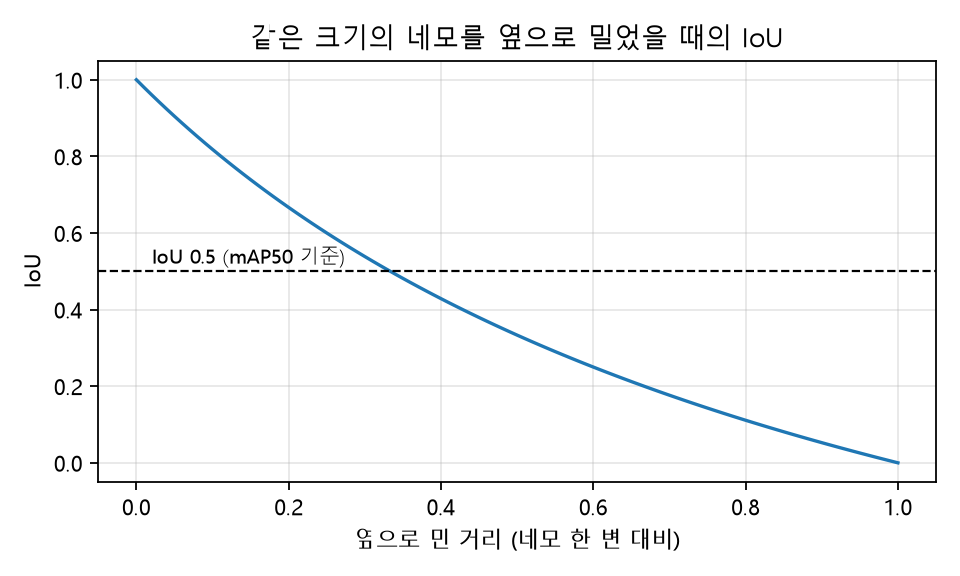

색종이 두 장을 겹쳤다고 생각해 보세요. 겹친 부분이 넓을수록 IoU는 1에 가까워져요. **mAP50의 "50"은 바로 이 IoU 기준이 0.50이라는 뜻**이에요. 절반 이상만 제대로 겹치면 "찾았다"고 인정해 주는 거예요. mAP50-95는 기준을 0.50, 0.55, … 0.95로 점점 엄격하게 바꿔 가며 매긴 점수의 평균이라서, 네모를 딱 맞게 그려야 높게 나와요.

### TP, FP, FN: 맞힘, 헛짚음, 놓침

**로봇의 네모를 채점하면 결과는 세 가지 중 하나예요.** 고양이 예시에서는 TP 7개, FP 4개, FN 3개예요.

| 이름 | 쉽게 말하면 | 뜻 | 고양이 예시 |
| --- | --- | --- | --- |
| TP (True Positive) | 맞힘 | 네모를 그렸고, 진짜 고양이와 IoU 0.5 이상 겹침 | 7개 |
| FP (False Positive) | 헛짚음 | 네모를 그렸는데 고양이가 없거나 너무 빗나감 | 4개 (쿠션, 그림자 등) |
| FN (False Negative) | 놓침 | 진짜 고양이가 있는데 네모를 안 그림 | 3마리 |

외우는 방법: **앞 글자 T/F는 로봇이 맞았는지 틀렸는지, 뒷 글자 P/N은 로봇이 있다고 했는지 없다고 했는지**를 뜻해요. FP는 "있다고 했는데(P) 틀림(F)", FN은 "없다고 했는데(N) 틀림(F)", 즉 놓친 것이에요.

한 고양이에 네모를 두 개 그리면, 먼저 맞힌 하나만 TP이고 나머지는 FP가 돼요.

### Confidence: 로봇의 자신감 점수

**Confidence는 로봇이 네모마다 붙이는 "이건 고양이가 맞을 거야" 자신감 점수(0~1)예요.** 0.95는 "거의 확실해", 0.10은 "아마 아닐 것 같은데…"라는 뜻이에요.

고양이 예시의 네모 11개를 자신감이 높은 순서로 줄 세우면 이래요.

| 순서 | 자신감 | 채점 결과 |
| --- | --- | --- |
| 1 | 0.95 | 맞힘(TP) |
| 2 | 0.90 | 맞힘(TP) |
| 3 | 0.85 | 맞힘(TP) |
| 4 | 0.80 | 헛짚음(FP) |
| 5 | 0.70 | 맞힘(TP) |
| 6 | 0.60 | 맞힘(TP) |
| 7 | 0.50 | 헛짚음(FP) |
| 8 | 0.40 | 맞힘(TP) |
| 9 | 0.30 | 헛짚음(FP) |
| 10 | 0.20 | 맞힘(TP) |
| 11 | 0.10 | 헛짚음(FP) |

우리는 **기준선**(confidence threshold)을 정해서 "자신감이 이 선보다 높은 네모만 믿겠다"고 할 수 있어요. 기준선을 0.8로 두면 위의 4개만, 0.2로 두면 10개를 사용해요. 기준선을 어디에 두느냐에 따라 점수가 달라지는데, 그게 뒤에 나오는 내용의 핵심이에요.

### Precision과 Recall: 두 가지 성적표

**Precision(P)은 "로봇이 그린 네모 중 몇 %가 진짜였나"이고, Recall(R)은 "진짜 고양이 중 몇 %를 찾았나"예요.** 둘 다 높을수록 좋아요.

```
Precision = TP / (TP + FP)        Recall = TP / (TP + FN)
```

기준선을 0.6으로 두면 자신감 0.6 이상인 네모 6개만 사용해요. 그중 맞힘이 5개, 헛짚음이 1개이고, 고양이 10마리 중 5마리는 놓쳤어요.
- Precision = 5 ÷ (5 + 1) = **0.83**: "고양이다!"라고 한 말 중 83%가 맞았어요.
- Recall = 5 ÷ (5 + 5) = **0.50**: 숨은 고양이의 절반만 찾았어요.

비유하면 Precision은 **신중함**, Recall은 **꼼꼼함**이에요. 학습 로그의 R이 0.74라면 "검증 이미지 속 진짜 물체 100개 중 74개를 찾고 26개를 놓쳤다"는 뜻이에요.

### 기준선을 바꾸면 생기는 일

**기준선을 낮추면 네모를 더 많이 쓰게 되어 Recall은 오르고, 헛짚음도 같이 들어와서 Precision은 내려가요.** 둘은 시소처럼 한쪽이 올라가면 다른 쪽이 내려가는 관계예요.

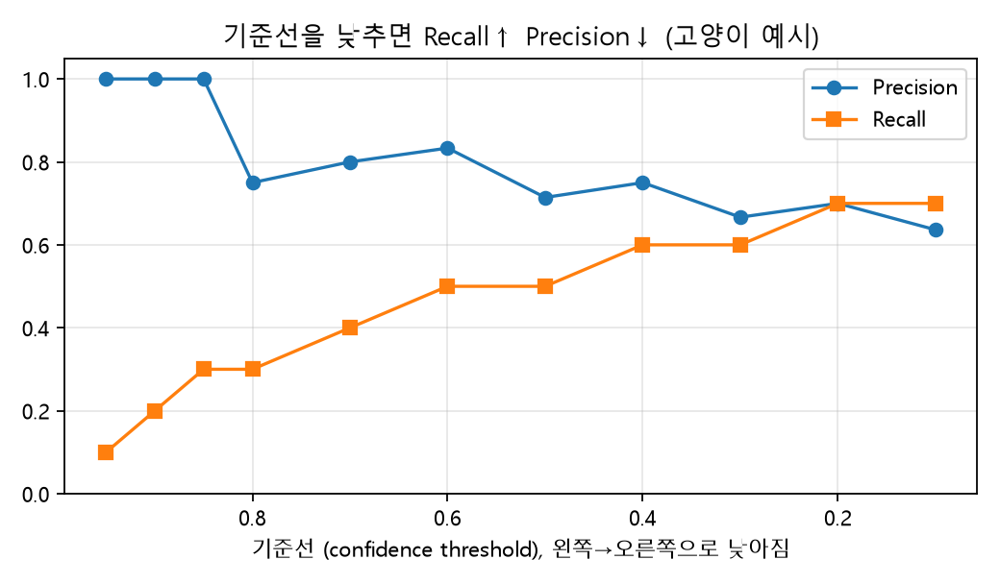

기준선을 끝까지 낮춰도 Recall은 0.70에서 멈춰요. 로봇이 아예 네모를 안 그린 고양이 3마리는 기준선을 어떻게 바꿔도 찾을 수 없기 때문이에요. 이 점이 뒤에서 mAP50의 천장이 돼요.

### AP와 mAP50: 곡선 아래 넓이

**AP(Average Precision)는 기준선을 하나로 정하지 않고, 모든 기준선에서의 성적을 한 점수로 묶은 것이에요.** 기준선마다 잰 (Recall, Precision)을 점으로 찍고 이으면 PR 곡선이 되고, 그 아래 넓이가 AP예요.

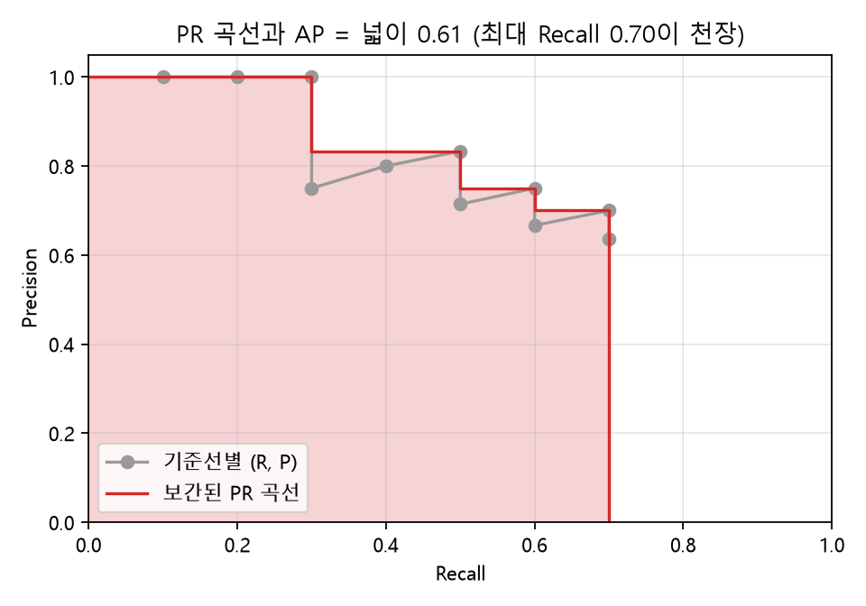

곡선이 오른쪽 위 구석까지 꽉 차 있을수록(많이 찾으면서도 헛짚지 않을수록) 넓이가 1에 가까워져요. 고양이 예시의 AP는 0.61이에요.
- **m(mean)**은 평균이에요. 클래스가 여러 개면 클래스마다 AP를 구해 평균을 내요. 예를 들어 고양이 AP가 0.61, 강아지 AP가 0.81이라면 mAP는 (0.61 + 0.81) ÷ 2 = 0.71이에요.
- **50**은 맞힘(TP)을 판정할 때 IoU 0.5를 기준으로 썼다는 뜻이에요.

즉 **mAP50 = IoU 0.5 기준으로 채점한, 모든 클래스의 PR 곡선 아래 넓이의 평균**이에요. (ASH-E 담배 모델은 클래스가 `cigarette` 하나뿐이라 mAP50 = 담배 클래스의 AP50입니다.)

### Recall과 mAP50의 관계

**R은 곡선 위의 점 하나, mAP50은 곡선 아래 넓이 전체예요.** 그래서 둘은 다음 세 가지로 연결돼요.
1. **최대 Recall이 mAP50의 천장이에요.** 고양이 예시에서는 기준선을 아무리 낮춰도 Recall이 0.7에서 멈춰요. 그래서 AP는 어떤 경우에도 0.7을 넘을 수 없어요. 놓친 3마리가 점수에서 0.3을 통째로 깎은 셈이에요.
2. **자신감 순서도 중요해요.** 맞힘이 자신감 높은 쪽에, 헛짚음이 낮은 쪽에 모여 있을수록 곡선이 위쪽에 오래 머물러 넓이가 커져요. 같은 Recall이라도 mAP50은 다를 수 있는 이유예요.
3. **학습 로그의 R은 한 지점에서 잰 값이에요.** Ultralytics YOLO는 P와 R의 균형(F1 점수)이 가장 좋은 기준선을 골라 그때의 P와 R을 보여줘요. 고양이 예시라면 기준선 0.2에서 P 0.70, R 0.70이 찍혔을 거예요.

그래서 모델을 고를 때는 한 지점의 R보다 전체를 요약한 mAP50(또는 mAP50-95)을 기준으로 삼는 게 보통이에요. R은 "왜 점수가 낮은지" 원인을 찾을 때 보조 지표로 쓰면 돼요.

### 학습 로그 읽는 법

**P·R·mAP50의 조합을 보면 모델이 어디서 막히는지 짐작할 수 있어요.**

| 보이는 모습 | 무슨 뜻인가 | 해볼 만한 것 |
| --- | --- | --- |
| R 낮음, P 높음 | 확실한 것만 찾고 많이 놓침 | 작은 물체 확인, 입력 해상도(imgsz) 올리기, 데이터 늘리기, 라벨 누락 점검 |
| R 높음, P 낮음 | 많이 찾지만 헛짚음도 많음 | 물체 없는 배경 이미지 추가, 헷갈리는 클래스 라벨 점검 |
| mAP50은 높은데 mAP50-95는 낮음 | 위치는 맞지만 네모가 딱 맞지 않음 | 라벨 네모 품질 점검, 더 오래 학습 |
| R과 mAP50이 같이 제자리 | 모델이나 데이터가 한계에 도달 | 더 큰 모델, 데이터의 양과 품질 개선 |

학습이 진행되면서 보통 R과 mAP50은 함께 오르는데, R만 오르고 P가 떨어지면 헛짚음이 늘고 있다는 신호예요.

### 용어 사전

| 용어 | 한 줄 뜻 |
| --- | --- |
| IoU | 예측 네모와 정답 네모가 겹친 정도 (0~1) |
| TP | 맞힘: 진짜 물체를 IoU 기준 이상으로 맞게 찾음 |
| FP | 헛짚음: 없는 것을 있다고 하거나 네모가 너무 빗나감 |
| FN | 놓침: 있는 물체를 찾지 못함 |
| Confidence | 네모마다 붙는 로봇의 자신감 점수 (0~1) |
| Confidence threshold | 이 점수 이상인 네모만 사용하는 기준선 |
| Precision (P) | 찾은 것 중 맞힌 비율 = TP ÷ (TP + FP) |
| Recall (R) | 진짜 물체 중 찾은 비율 = TP ÷ (TP + FN) |
| F1 | P와 R을 함께 보는 균형 점수 |
| PR 곡선 | 기준선을 바꿔 가며 (R, P)를 이어 그린 선 |
| AP | 한 클래스의 PR 곡선 아래 넓이 |
| mAP50 | IoU 0.5 기준 AP를 모든 클래스에 대해 평균 낸 값 |
| mAP50-95 | IoU 기준을 0.50부터 0.95까지 바꿔 가며 구한 mAP의 평균 |
